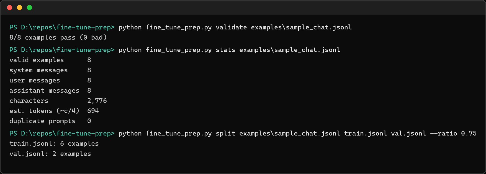

# fine-tune-prep

[](https://github.com/amanvicky/fine-tune-prep/actions/workflows/ci.yml)

Every first fine-tune dies on the dataset, not the training script. This is the boring half, done locally and for free: **validate** a chat JSONL file line by line, **see** what's actually in it, **split** it deterministically, and **convert** CSV Q/A rows into the right shape. Zero dependencies.



## The format

One `{"messages": [...]}` object per line, roles `system` / `user` / `assistant` — the shape OpenAI-style fine-tuning expects. [`examples/sample_chat.jsonl`](examples/sample_chat.jsonl) is a working 8-example study-tutor dataset, so every command runs out of the box:

```bash
python fine_tune_prep.py validate examples/sample_chat.jsonl
```

## What each command does

| Command | Job |
|---|---|
| `validate PATH` | every problem with its line number — bad JSON, missing `messages`, unknown roles, empty content, then a pass/bad summary. Exit code 1 when anything is wrong, so it slots into scripts |
| `stats PATH` | role counts, total characters, an estimated token count, duplicate prompts |
| `split SRC TRAIN VAL` | deterministic train/val split — same `--seed`, same split, every time; nothing lost or duplicated |
| `convert SRC DEST` | CSV `prompt,answer[,system]` rows → chat JSONL, quoted commas handled |

The token figure is a **heuristic** (chars ÷ 4), not a tokenizer — use it to sanity-check dataset size, not to predict a bill.

## Run

```bash
git clone https://github.com/amanvicky/fine-tune-prep
cd fine-tune-prep
python fine_tune_prep.py validate examples/sample_chat.jsonl
pytest tests/ -q      # 10 tests, stdlib only
```

## Why it exists

My [Genesis](https://github.com/amanvicky/Genesis-Business-Decoding-Engine) project needs agents that produce structured output, and my [leyp](https://github.com/amanvicky/leyp) job-hunt tool fine-tunes nothing but taught me the pattern: before you pay a single rupee of training compute, your dataset needs to be *provably* clean. This is that proof step, separated out for anyone learning LLM work — pair it with [attention-from-scratch](https://github.com/amanvicky/attention-from-scratch) for what happens under the training.
